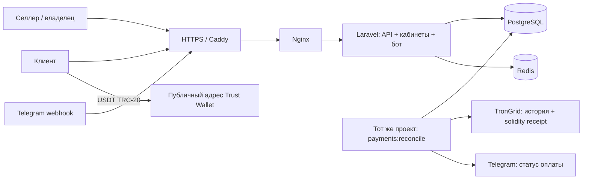

# MVP: владелец, селлеры и Trust Wallet

Один Laravel 12 / Vue проект, PHP 8.4+, PostgreSQL 17. API, кабинеты, Telegram webhook и обработчики используют общие сервисы и одну БД. Docker запускает тот же образ отдельными процессами HTTP, очереди и планировщика. Это монолит, а не независимые микросервисы. Redis обслуживает сессии, ограничения запросов и доставку уведомлений; состояние платежей хранится в PostgreSQL.



## Роли

* `admin` — владелец: видит все счета и общую статистику, создаёт/блокирует селлеров, управляет настройками. Адрес приёма задаётся оператором VPS через `PAYMENT_RECEIVE_ADDRESS`; селлер не может заменить его.
* `user` — селлер: свои магазины, клиенты, счета и API-ключ. Обращение к чужому счёту по API возвращает 404. Заблокированный селлер не проходит API-аутентификацию.
* Клиент не получает кабинет продавца. Платёжная ссылка содержит непредсказуемый ULID; она является доступом к ограниченной информации о платеже. Персональные данные клиента, metadata, callback URL и Telegram-токен в публичном ответе отсутствуют.

## Привязка заказа к платежу

Trust Wallet используется как кошелёк владельца. Сервер знает только публичный адрес. Подписание, вывод, возврат и распределение выручки между селлерами не входят в этот MVP.

1. Селлер создаёт счёт; `external_invoice_id` уникален в пределах селлера. Повтор с теми же параметрами возвращает прежний счёт, с другими — ошибку.
2. В транзакции БД блокируется строка общего адреса. `requested_amount` хранит исходную цену в минимальных единицах; `amount` — точную сумму к переводу. Если сумма уже использовалась, добавляются минимальные единицы (0,000001 USDT), максимум 0,009999 USDT. При исчерпании диапазона создание отклоняется.
3. Пара `(address_id, amount)` уникальна навсегда, включая просроченные и отменённые заказы. Не удалять счета/журнал и не переиспользовать суммы. Клиент видит надбавку и переводит итоговую сумму без округления. Это ограниченная модель для небольшого потока; перед ростом нагрузки перейти на отдельные депозитные адреса с внешним хранением ключей.
4. История TRC-20 служит только поиском кандидатов. Страницы читаются по fingerprint, проверяются адрес и контракт; верхний предел — 100 страниц по 200 записей за семь дней. Переполнение и ошибки провайдера блокируют зачёт и требуют вмешательства.
5. Для кандидата запрашивается `/walletsolidity/gettransactioninfobyid`. Нужны `SUCCESS`, совпадающий txid, корректный `Transfer` официального контракта, адрес получателя, целочисленная сумма и время блока в окне заказа. В MVP принимается только транзакция с одним Transfer этого токена; пакетные переводы оставляются на разбор.
6. Сеть закреплена за БД и счётом, URL провайдера соответствует `mainnet` или `nile`, mainnet-контракт проверяется по фиксированному адресу. Одна БД не обслуживает разные сети. Доверие к данным TronGrid остаётся границей системы; собственная нода/второй провайдер — следующий этап.
7. Перед `paid` квитанция проверяется повторно. Требуется как минимум 20 блоков, считая блок транзакции, относительно **solidified** вершины; настройка может только увеличить порог. Это дополнительный консервативный порог поверх финальности TRON, а не утверждение о протокольном минимуме.
8. Уникальный `(network, txid)` и блокировка счёта предотвращают повторный зачёт. Переходы записываются в `payment_audit` в той же транзакции. Ручной `paid` запрещён.

## Состояния и восстановление

`pending → processing → paid`; `pending → expired` или `cancelled`.

Обнаруженный вовремя перевод продолжает проверяться после истечения таймера. Просроченный счёт может перейти в `processing`, если квитанция доказывает включение платежа до дедлайна: это восстановление после задержки индекса/сбоя. Отменённые счета автоматически не восстанавливаются. Перевод после дедлайна, частичная/избыточная сумма или пакетный перевод не оплачивают заказ автоматически; владелец разбирает их отдельно. После простоя более семи дней требуется отдельная сверка истории.

Планировщик каждую минуту восстанавливает работу из БД. Очередь не является единственным носителем задания на проверку. История адреса кешируется только на 15 секунд внутри процесса. Ответы 429/5xx и таймауты не переводят счёт в `paid`; следующая попытка — на очередном запуске. После аварийного завершения блокировка планировщика может сохраняться до 60 минут; оператор проверяет процесс перед очисткой блокировки.

## Telegram

В деталях счёта и API есть `telegram_url`. Селлер передаёт её конкретному клиенту как секретную ссылку. `/start pay_<token>` в личном чате привязывает счёт к первому чату; другой чат не может перехватить привязку. `/status` показывает только привязанные этому чату счета. После `paid` планировщик отправляет уведомление; ошибка отправки повторяется. При сбое между отправкой и фиксацией результата возможно повторное уведомление, но повторного платежа нет.

Привязка аккаунта селлера через существующий `/start <token>` действует 15 минут и одноразовая. Webhook требует `X-Telegram-Bot-Api-Secret-Token`. Никакие команды бота не устанавливают `paid`.

## Структура

```text
app/Http/Controllers/      API, кабинеты и Telegram webhook
app/Services/Invoice/      резервация суммы, идемпотентность, переходы статусов
app/Services/Blockchain/   TronAddress, TronReceipt, BlockchainService
app/Console/Commands/     payments:reconcile, payments:configure-address
app/Telegram/Commands/    start, status
app/Jobs/                 уведомления и существующие очереди
app/Models/               Invoice, Address, User, Merchant, Client
resources/js/             Vue: кабинеты владельца/селлера, платёжная форма
database/migrations/      PostgreSQL-схема, ограничения и payment_audit
tests/Feature/            платежная безопасность и существующие тесты приложения
deploy/                   Nginx, Caddy
compose.yaml              приложение, worker, scheduler, PostgreSQL, Redis, HTTPS
docs/                     архитектура, запуск, roadmap и API
```

## Источники решений

* [TRON: семантика подтверждения](https://developers.tron.network/docs/confirmation-semantics)
* [TRON: формат событий и Transfer](https://developers.tron.network/docs/event)
* [Tether: официальный контракт TRC-20](https://tether.to/en/supported-protocols/)
